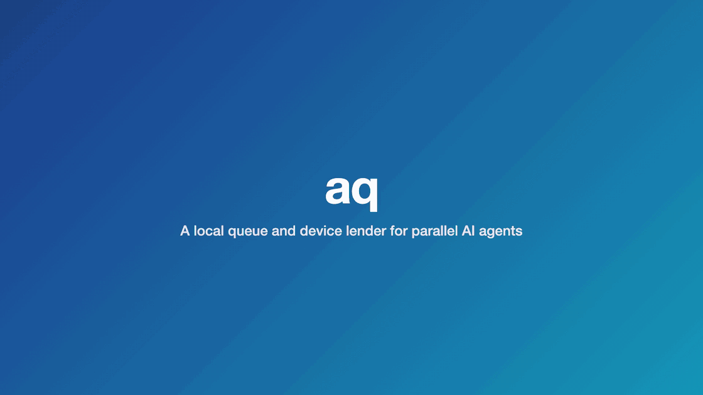

# demo-reel

English · [简体中文](README.zh-CN.md)

A skill for coding agents that turns a short script into polished product demos: the film you post on X and YouTube, the GIF and video for your README. Commands really run, the camera follows the action, waits are cut, every step has a caption, and the files fit each platform. After a change, re-recording is one sentence to your agent.



<sub>Produced by demo-reel from [examples/aq/cli](examples/aq/cli). Every aq call in it is real.</sub>

## What you get

| File | For | Content |
|---|---|---|
| `share.mp4` (1920×1080 H.264 High) | X and YouTube | The full story, up to 90 s: a hook, the problem, why the usual way fails, your tool, the result, how to install |
| `readme.mp4` (1280×720, under 10 MB) | The README video | The same without the hook and the name reveal |
| `assets/<name>.gif` (under 10 MB) | The top of your README | One scene, up to 30 s, looping |

- **Recorded for real.** A step that waits for output fails the take if it never shows, so you never get a demo of a broken run. Every scene is rehearsed off camera first.
- **A camera that follows the action.** It pushes in on the lines that change and pulls back at the end. Phones, pages and windows are shown whole.
- **Readable without sound.** Captions on every step. Optional local narration in English or Chinese (Kokoro), or talk over the film yourself on camera (`reel narrate`).
- **Numbers from the recording.** Result cards and timer bars are computed from what the scenes logged, never typed in.
- **Checked before you see it.** Size, format and length limits, OCR every half second for tokens, keys, home paths and your own private patterns, narration loudness, and deliverables that match the latest edit.
- **Only what changed is redone.** Change a caption and the film is edited again without recording.

Subjects: terminal CLIs (VHS + tmux), iOS and Android apps on simulators, emulators or phones (agent-device), web pages (agent-browser), Mac app windows (agent-desktop + screencapture). macOS only.

## Quick start

```bash
git clone https://github.com/xiatiandeairen/demo-reel ~/demo-reel
ln -s ~/demo-reel/skill ~/.claude/skills/demo-reel   # for Claude Code
~/demo-reel/bin/reel make ~/demo-reel/examples/hello/cli/reel.toml
```

Then ask your agent: "record a demo of this project for the README". Before writing anything it agrees with you on the language, the look, the one thing the GIF shows, the scenes, every caption and where each number comes from. It then writes the script into your project under `.agents/demo-reel/<name>/`, prepares the demo environment, runs `reel make`, reviews the contact sheets and reports the files.

A reel is a folder:

```
.agents/demo-reel/cli/
  reel.toml          language, look, which scenes each file uses, result cards
  scenes/with.toml   one scene: what to type or tap, what to wait for, what the caption says
  scripts/           the agent's preparation and reset scripts
```

```toml
# scenes/with.toml
kind = "terminal"
reset = "bash scripts/setup.sh $REEL_WORK"   # run before the rehearsal and before the take

[terminal]
workdir = "/tmp/aq-demo-with"                 # paths on screen never show your home folder

[[pane]]
name = "agent A"
[[pane]]
name = "aq status --top"
run = "aq status --top"                       # a live dashboard

[[step]]
pane = "agent A"
type = "aq run -- ./build.sh"
wait = "ok"                                   # fails the take if this never appears
say = "With aq, the same build runs once."
```

## Commands

| Command | Does |
|---|---|
| `reel make <reel.toml> [--rerecord]` | Preflight, narration, rehearsal, take, edit, cards, join, export, checks, contact sheets; redoes only what changed. `--rerecord` records again, e.g. after the demoed tool was upgraded |
| `reel narrate <reel.toml> [--cut share\|readme]` | Run it yourself: plays the film while recording your camera and voice, and adds a picture-in-picture presenter with captions from what you said |

## Where files go

The script lives in your project (`.agents/demo-reel/<name>/`) and the GIF goes to `<project>/assets/<name>.gif`, never over a file demo-reel did not write. Everything else follows the XDG folders: recordings and edits in `$XDG_STATE_HOME/demo-reel/` (default `~/.local/state`), the mp4s, report and contact sheets in `$XDG_DATA_HOME/demo-reel/` (`~/.local/share`), voice models in `$XDG_CACHE_HOME/demo-reel/` (`~/.cache`). Private sensitive-text patterns (company domains, internal hosts) go in `~/.config/demo-reel/private.txt`, one regular expression per line, so they never enter a repository.

## Requirements

macOS, Python 3.11+, ffmpeg, Google Chrome. Terminal: vhs, tmux, Homebrew bash. iOS: agent-device and Xcode; Android: agent-device and the Android SDK (adb, emulator); a real phone needs to be unlocked with UI automation or USB debugging on. Web and animations: agent-browser. Mac windows: agent-desktop, an awake display and Screen Recording permission. Narration: uv (installs Kokoro on first use).

## License

MIT or Apache-2.0, at your option.
