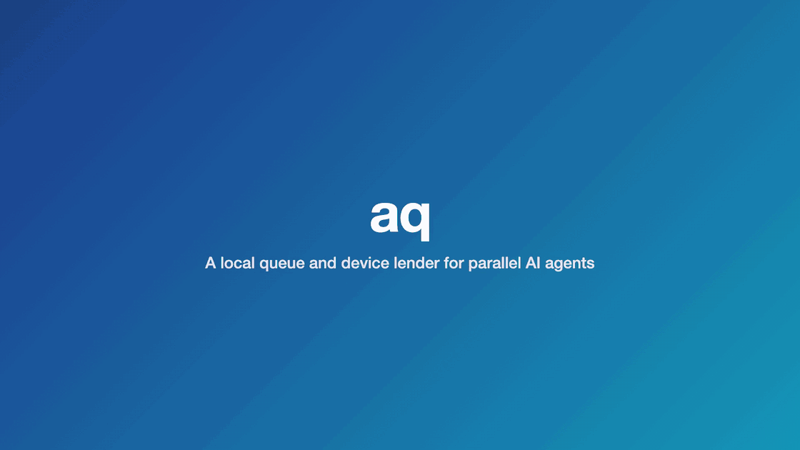

# demo-reel

[English](README.md) · 简体中文

把一份简短的分镜变成能发 X、能放 README 的产品演示：命令真实执行，镜头跟着动作走，长等待自动剪掉，带标题卡和标注，导出的文件符合各平台限制。为 coding agent 驱动而设计，代码改了以后一句话就能重录。



<sub>上面这段由 demo-reel 根据 [examples/aq/reel.toml](examples/aq/reel.toml) 生成，里面每次 aq 调用都是真实执行。</sub>

## 能得到什么

- **一份分镜，各平台都有。** X 时间线用的 `x.mp4`（1920×1080 H.264），GitHub 用的 `readme.gif` 和 `readme.mp4`，都在平台的大小限制以内。
- **镜头跟着动作走。** 录制时记下每一步的开始时间，再从画面看哪里在变；镜头平滑移到那里，超过两秒的静止画面被剪掉。
- **交付前先检查。** 格式、时长、大小上限、首帧是否看得清，并每半秒做一次文字识别，查 token、API key、家目录路径和你自己的私有规则。
- **真实运行，不摆拍。** 写了"等待某段输出"的步骤，等不到就判录制失败，不会产出一段跑坏了的演示。

支持的对象：终端 CLI（VHS + tmux）、iOS 模拟器或真机上的 App（agent-device）、网页（agent-browser）、Mac 应用窗口（agent-desktop + screencapture）。

## 快速开始

```bash
git clone https://github.com/xiatiandeairen/demo-reel ~/demo-reel
ln -s ~/demo-reel/skill ~/.claude/skills/demo-reel   # 给 Claude Code 用
~/demo-reel/bin/reel make ~/demo-reel/examples/aq/reel.toml
```

之后对 agent 说"给这个 CLI 录个 README 用的演示"。它会在项目里写 `docs/demo/reel.toml`，运行 `reel make`，再报告产出的文件和检查结果。分镜写法见 [examples/](examples/) 和 [README.md](README.md#quick-start) 里的示例。

## 命令

| 命令 | 作用 |
|---|---|
| `reel make <reel.toml>` | 依次执行下面全部步骤 |
| `reel record <reel.toml>` | 录出 `stage.mp4` 和 `events.json`（每步时间、窗格位置） |
| `reel plan <reel.toml>` | 生成 `timeline.json`：镜头、剪辑点、标注 |
| `reel compose <目录>` | 合成 `master.mp4` |
| `reel export <目录>` / `reel check <目录>` | 把各平台文件导出到 `<目录>/out`，然后检查 |
| `reel sheet <目录>` | 出一张覆盖全片的 24 格联系表，用来审片 |
| `reel sync <目录>` | 对比记录的步骤时间和画面实际变化的时刻 |

合成只用 ffmpeg；标题卡和标注由无界面的 Chrome 绘制。

## 依赖

macOS、Python 3.11+、ffmpeg、Google Chrome。终端演示另需 vhs、tmux、Homebrew bash；iOS 需 agent-device 和 Xcode 模拟器，真机还要用你们团队的签名运行 agent-device 的测试程序（在环境变量里设好 `AGENT_DEVICE_IOS_*`）、手机解锁并打开 Enable UI Automation；网页需 agent-browser。设备和浏览器通过 [aq](https://github.com/xiatiandeairen/agent-quay) 借用。录 Mac 窗口时屏幕要亮着，并且运行 reel 的程序有屏幕录制权限。

敏感信息检查的私有规则（公司域名、内网主机名）写在 `~/.config/demo-reel/private.txt`，每行一个正则表达式，这样它们不会进任何仓库。

## 许可

MIT 或 Apache-2.0，任选其一。
